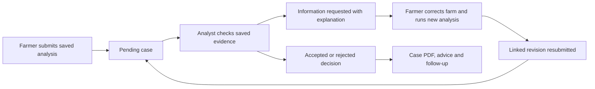

# Analyst and planner workflow implementation

27 October 2026. Implements the [analyst/planner review](../../web-review-2026-10-27/ANALYST_PLANNER_APPROACH.md). NPK, soil pH, new datasets and model retraining remain on hold at the owner's request. Mobile acceptance remains deferred.

## What changed

| Increment | Delivered software | Skills used | Evidence |
| --- | --- | --- | --- |
| 1. Evidence and decision meaning | Model-score wording; neutral recorded-measurement maps; missing-value states; selected-area workspace without unrelated historical distribution; actual loading/error state and retained previous evidence after failure | [Analysis](../../web-fix-plan/skills/geosustain-web-analysis/SKILL.md), [data](../../web-fix-plan/skills/geosustain-web-data/SKILL.md) | Flutter suite, measured-scale tests, recorded maps |
| 2. Review cases | Routed workbench, checklist, required reason/explanation, request information, linked farmer revision, immutable older analysis, decision timeline, version conflict handling | Analysis, [account safety](../../web-fix-plan/skills/geosustain-web-account-safety/SKILL.md) | Real isolated SQL/API acceptance; cancellation/stale-response widget test |
| 3. Bounded operator workspace | Workload overview; server search/date/place/status/workload filters; 20-row inbox and independent 50-row map; submitted-age ordering; retained filters and inbox position; explicit case/farm/area scope | Data, [shell](../../web-fix-plan/skills/geosustain-web-shell/SKILL.md) | 500-case SQL fixture; independent-controller tests; 390/768-pixel reflow tests |
| 4. Reports, tasks and acceptance | Scoped planning PDF; case decision PDF; advisory notes; assigned follow-up creation/completion; due activity on refresh; case links from activity; owned farmer response page | [PDF](C:/Users/jasph/.codex/plugins/cache/openai-primary-runtime/pdf/26.1020.11127/skills/pdf/SKILL.md), [accessibility](../../web-fix-plan/skills/geosustain-web-accessibility/SKILL.md), [final QA](../../web-fix-plan/skills/geosustain-web-final-qa/SKILL.md) | Synthetic PDF exports rendered and inspected; task ownership/due reminder deduplication in real SQL |

Source-fixed, local-tested, deployed, live-tested and owner-accepted are separate milestones. See [validation](VALIDATION.md) for exact scope and [release evidence](RELEASE.json) for publication status.

Open [the workflow QA extension](QA_UPDATE.md) for individual test outcomes and limits.

See [executed test results](TEST_RESULTS.md) for counts, source identities and the exact remaining acceptance targets.

## Where to use it

- **Overview:** review workload first; personal analysis activity below it. Apply a place filter, open the matching case view from a metric, or export the current planning summary.
- **Review Inbox:** search/filter submitted cases, change submission order and page through server results. Select a case to open its full-page workbench.
- **Case workbench:** inspect recorded boundary, measurements, coverage and evidence. Compare recorded versus current farm geometry. Complete the evidence checklist to accept; give a reason and explanation to request information or reject. Review old revisions, export the case report, send advice and create/complete your follow-ups.
- **Planning Map:** filter an independent page of submitted cases. Search the visible map area explicitly; bounds apply to parcel centers. Colors represent review status. Open a case for saved observations, not an implied citywide infrastructure layer.
- **Farmer correction:** Activity -> My review cases and corrections -> requested case. Open the farm, correct it, run a new analysis of that same farm, refresh the case, describe the correction and submit the new linked revision. Earlier snapshots and decisions stay available.
- **Analysis Workspace:** select a point or completed polygon, run analysis, inspect coverage and results, then save/export. A point is location screening; it is not a whole-farm measurement. On a failed new run, prior evidence is shown separately and labelled as a previous result.

## Evidence and remaining acceptance

- `backend-tests.txt`: existing backend regression suite.
- `sql-workflow.txt`: actual PostgreSQL transactions and FastAPI requests, in a verified disposable local schema; no production writes or fabricated inference/provider receipt.
- `flutter-tests.txt`, `final-focused-tests.txt`, `flutter-analysis.txt`, `ruff.txt`: application regression and static checks.
- `synthetic-*.pdf` and rendered page PNGs: deliberately synthetic fixtures, not real farm assessments.
- `BROWSER_CHECKS.md`: actual browser observations, fixes and remaining targets.
- `FINDING_CROSSWALK.csv`: each AP finding mapped to implementation and acceptance scope.

The original 191-row capstone QA register remains dated evidence: **69 PASS, 83 PARTIAL, 3 FAIL, 17 NEEDS-MANUAL, 19 N/A**. These checks do not promote unrelated rows or replace actual owner/adviser acceptance. Email/Firebase/Google/SMS/background-push receipt, soil evidence, independent review, mobile retest and the full browser/screen-reader matrix retain their previous pending status.

No passwords, tokens, service-account keys or real personal farm payloads belong in published evidence. The local QA sign-in note is outside the repository.
